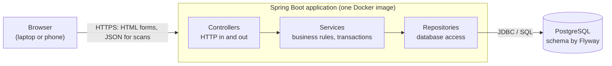
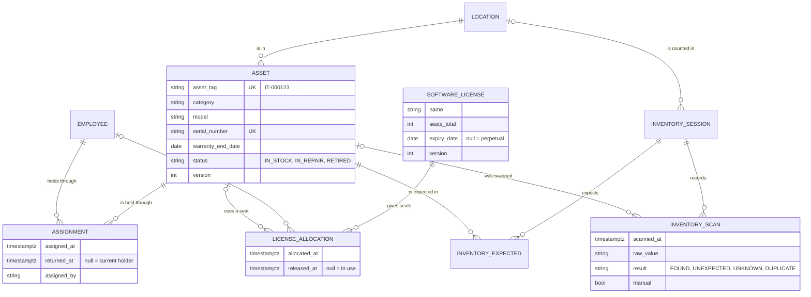
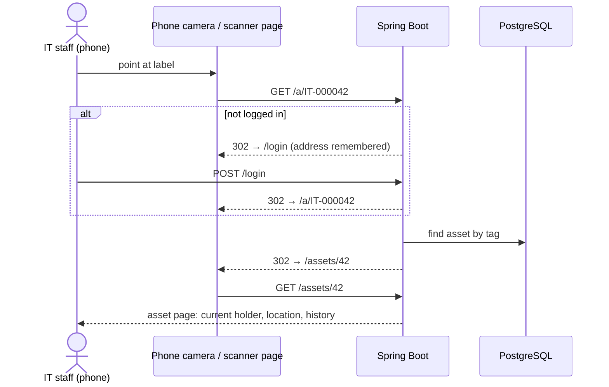

# How the app works

This document explains how the system is built and why: the architecture, the data model, the main flows (a request, a scan, an inventory), security, the import, and the tests. The design decisions behind it are recorded as ADRs in [architecture/](architecture/README.md).

## 1. The big picture
The system is one Spring Boot application with one PostgreSQL database. Pages are rendered on the server (Thymeleaf), so the browser receives finished HTML. JavaScript is used only where the page has to react live: the camera scanner and the inventory page.

**The layers.** Every request goes down and back up the same path:
- **Controller** (`*Controller`): reads the request, calls one service, chooses the page or JSON to return. It contains no business rules.
- **Service** (`*Service`): holds the rules, for example "an asset has at most one holder" or "never more seats than bought". Each method that changes data runs in one database transaction (`@Transactional`), and the change-log entry is written in that same transaction. Either both are saved or neither is.
- **Repository** (`*Repository`): Spring Data JPA interfaces. Most queries are derived from the method name, and the rest are written in JPQL or SQL.
- **PostgreSQL**: also enforces the most important rules itself (section 3), so even a bug in Java can't break them.

**Packages by feature** ([ADR 002](architecture/adr-002-package-by-feature.md)), under `io.github.andi005.qram`:

| Package | What it contains |
|---|---|
| `asset` | assets, locations, tag generation, search |
| `employee` | employees (deactivated, never deleted) |
| `assignment` | assign and return, the history of holders |
| `license` | licenses, seats, allocations |
| `history` | the change log (audit trail) |
| `qr` | QR images, label sheet, `/a/{tag}`, the scanner page, the tag parser, the JSON lookup |
| `inventory` | inventory sessions, scans, found/missing/unexpected logic, CSV export |
| `importer` | CSV parsing, row validation, the all-or-nothing import |
| `dashboard` | start page and the 90-day expiry view |
| `security` | login, users, roles, URL rules |
| `common` | shared helpers: clock, settings, formatting, CSV safety, demo data |

## 2. What happens on a request (example: saving an asset)
1. The browser sends `POST /assets` with the form fields and a hidden CSRF token.
2. **Spring Security** checks the session cookie (is the user logged in?), the CSRF token, and the URL rule (`POST` needs IT_STAFF or ADMIN). A failed check ends the request here: login page, 403, or 401 for the JSON API.
3. **`AssetController.create`** receives the form as an `AssetForm` record. The form binds to a record, never to the entity, so nobody can post fields like the tag or the version. Bean Validation (`@NotBlank`, `@Size`, ...) runs first. If anything fails, the same form is shown again with the errors next to the fields.
4. **`AssetService.create`** checks the rules: the purchase date is not in the future, the warranty doesn't end before the purchase, and the serial number is not used by another asset. It takes the next tag from the database sequence, saves the asset, and writes a `CREATED` line to the change log. `@PreAuthorize("hasRole('IT_STAFF')")` checks the role a second time.
5. **`AssetRepository.save`** makes Hibernate run the `INSERT`. At commit, PostgreSQL checks its own constraints too.
6. The controller answers with a redirect to `/assets/{id}` (Post/Redirect/Get, so refreshing the page doesn't submit the form twice) and a one-time success message.
7. The browser loads the asset page. Thymeleaf fills `templates/assets/detail.html` with the data, and every text comes from `messages.properties`.

**Two people editing the same asset.** Each asset has a `version` number (`@Version`), which travels in a hidden form field. If someone else saved in the meantime, the versions differ, and the second person sees "someone else changed this" instead of silently overwriting the first person's change.

## 3. The data model

Also: `app_user` (logins and roles), `change_log` (the audit trail), `import_batch` (one row per successful import).

**Design choices worth knowing:**
- **"Assigned" is not a status.** An asset is assigned while it has an *open* assignment row (`returned_at is null`). The current holder and the history therefore come from one table and can never disagree.
- **History is never deleted.** Returning closes the row, deactivating keeps the employee, retiring keeps the asset. Foreign keys are `RESTRICT`, so the database refuses to delete anything that has history.
- **Rules enforced by PostgreSQL** (see `V1`-`V5` in `src/main/resources/db/migration/`):
  - a unique tag in the format `IT-NNNNNN`;
  - a unique serial number when present;
  - allowed statuses and categories;
  - warranty end ≥ purchase date;
  - at most one open assignment per asset (a *partial unique index*: `unique (asset_id) where returned_at is null`);
  - a license seat goes to an employee XOR an asset (a `CHECK`);
  - one open seat per license and holder;
  - seats > 0.
- **Time:** moments are `Instant` / `timestamptz` (stored in UTC). Calendar dates such as the warranty end are `LocalDate` / `date`. "Today" comes from one injected `Clock` in the `Europe/Belgrade` zone, which is what makes the expiry boundaries testable.
- **The schema belongs to Flyway.** Each change is a new versioned SQL file, and a migration is never edited after it has run. Hibernate only *validates* that the entities match (`ddl-auto: validate`), so the app refuses to start if they don't.

## 4. QR labels and scanning
**What a label holds** ([ADR 003](architecture/adr-003-labels-hold-a-url.md)): only `APP_BASE_URL/a/IT-000042`, and the tag printed under the code. There is no personal data and no secret on the label. Someone outside who scans it sees only the login page.

**Two ways to scan:**
1. **Any camera app** opens the URL directly, without anything to install. This is the path above.
2. **The scanner page** (`/scan`, uses html5-qrcode): the browser decodes the code and sends the raw text to `GET /api/assets/lookup?raw=...`. The server, not the browser, extracts the tag with `TagParser`. It accepts a full URL from *any* host (so old labels still work if the address ever changes) or a bare tag in any letter case, and it rejects everything else. The answer appears on the same page: device, status, holder, location.

**Why HTTPS matters:** phone browsers only allow the camera on secure origins (HTTPS or `localhost`). On plain HTTP, the page offers **"scan from a photo"**: the phone takes a picture and the code is decoded from the image.

**Labels** (`/labels`) are an HTML page with print CSS: three labels per row on A4, each with a QR code (a PNG made by ZXing on request, never stored) and the tag as text. You choose assets with the checkboxes in the asset list, or print all assets of a location.

## 5. Inventory sessions (for research question P2)
1. **Start** (`/inventory/new`): give the session a name and choose what is *expected*: every asset in use at a location, or a pasted list of tags. The clock starts.
2. **Scan** (`/inventory/{id}`, made for phones): every scan, from the camera, a photo or typed by hand, is sent as JSON to `POST /api/inventory/{id}/scans`. The server stores the raw value with a timestamp and classifies it:
   - **FOUND**: on the expected list, first time;
   - **UNEXPECTED**: a known asset that is not on the list;
   - **UNKNOWN**: not a valid or known tag;
   - **DUPLICATE**: already scanned in this session.

   The page updates the counters and the lists of found, missing and unexpected assets live. Typed entries are flagged `manual`, and their characters are counted ("amount of manual typing", one of the P2 measures).
3. **Finish:** the clock stops. Later scans are refused with HTTP 409.
4. **Export:** `summary.csv` holds one row of measurements (duration in seconds, expected, found, missing, unexpected, unknown, duplicates, manual entries, typed characters) plus the missing and unexpected assets. `scans.csv` has every scan with its time and seconds since the start. Both use `;` and UTF-8 with a BOM, so Excel in Albanian settings opens them correctly, and cells starting with `= + - @` are neutralised against formula injection.

The found/missing/unexpected logic is pure Java (`InventoryCalculator`) and unit-tested on its own. Each scan request takes a row lock on the session, so two phones scanning into one session can't both record a "first" scan.

## 6. Licenses, warranties and the 90-day view
- A license has a seat count and an optional expiry date (empty = perpetual). Seats are given to an employee or a device and released later. The history stays.
- **Seat limit:** giving a seat locks the license row first (`SELECT ... FOR UPDATE`), then counts the seats in use. Two people taking the last seat at the same moment are served one after the other, so the second one is refused. The seat count can't be lowered below the seats in use.
- **Warranties** are the `warranty_end_date` of each asset.
- **The 90-day rule** lives in one place, `common/ExpiryWindow`: *today ≤ date ≤ today + 90* is "expiring soon", earlier is "expired", and no date means it never expires. The `/expiring` view and the dashboard both use it. Retired assets are left out of the warranty lists.

## 7. CSV import
Excel → "Save as → CSV UTF-8" → `/import` (ADMIN only). The file is processed in memory and never stored.
- **Parsing** (`CsvAssetParser`) copes with a BOM, `;` or `,` as separator (detected from the header), columns in any order with Albanian or English headers, empty trailing rows, and old Windows-1252 files (with a warning). It accepts at most 5,000 rows.
- **Validation** (`ImportValidator`) collects *all* problems at once:
  - tag format and duplicates (in the file and against the database);
  - unknown category or status;
  - missing model;
  - serial format and duplicates;
  - dates in `dd.MM.yyyy` or ISO format, checked strictly (31.02 is refused), no purchase in the future, warranty not before purchase;
  - a location that differs from an existing one only by `ë`/`ç` or letter case (a typo that would otherwise create a second room).

  A missing serial number is a warning, not an error.
- **All or nothing** (`ImportService`): if there is any error, nothing is written and the report lists every problem with its line and column. If the file is valid, every row is written in one transaction, new locations are created, the tag sequence is moved past the imported tags, and an `import_batch` row and a change-log entry are added.

`docs/requirements/sample-data/MOCK-inventory.csv` is a fictional file with deliberate mistakes. `ImportValidatorTest` checks that each one is reported on the right line.

## 8. Security
- **Login:** form login with a session cookie. Passwords are stored as BCrypt hashes. The first `admin` account is created on the first start from `ADMIN_INITIAL_PASSWORD`, and users are managed by ADMIN at `/users`.
- **Roles** (`SecurityConfig`): ADMIN ⊃ IT_STAFF ⊃ VIEWER (a role hierarchy).
  - **VIEWER** reads everything, including the dashboard, expiry view, scan lookup and exports.
  - **IT_STAFF** also changes data: assets, employees, licenses, assignments, labels, inventories.
  - **ADMIN** also manages users and imports CSV.
- **Two layers** check every action: the URL rules, and `@PreAuthorize` on every service method that changes data. Hidden buttons (`sec:authorize` in templates) are only for convenience.
- **CSRF** protection is on for every form and for the JSON `POST`. The scanner script reads the token from a `<meta>` tag and sends it in a header.
- **`/api/**`** answers 401 instead of redirecting to the login page. The custom error pages are 403 and 404.
- **Output escaping:** Thymeleaf `th:text` escapes all output. The import and every form are validated on the server.
- **No secrets in Git:** all configuration comes from environment variables.
- **The last active ADMIN** can't be deactivated or demoted.

## 9. Tests
`./mvnw verify` runs everything. The integration tests use a real PostgreSQL 18 in Docker (Testcontainers), not H2, so the SQL and constraints are exactly the production ones.

| Test class | What it proves |
|---|---|
| `ExpiryWindowTest` | the 90-day boundaries: yesterday expired, today and day 90 in, day 91 out, no date |
| `TagParserTest` | full URL from any host, bare tag, lower case, query/fragment, garbage, too long, wrong path |
| `InventoryCalculatorTest` | found / missing / unexpected / unknown / duplicate |
| `ImportValidatorTest` | every deliberate mistake in the mock file on its line; separators, BOM, encodings, date formats |
| `AssetServiceTest` | tag generation, serial rules, date rules, concurrent edit, no retiring while assigned |
| `AssignmentServiceTest` | one holder, no assigning in repair, retired or to inactive employees; return |
| `LicenseServiceTest` | seat limit, release and reallocate, lowering seats, one seat per holder, stale version |
| `CsvSafeTest` | formula characters neutralised in exports |
| `RoleAccessTest` | the role table: endpoint × role → status, POST without CSRF → 403, API → 401 |
| `DatabaseConstraintsTest` | the PostgreSQL constraints, tested with raw SQL |
| `AssignmentRollbackTest` | a failing change-log write rolls back the assignment |
| `ImportServiceTest` | the mock file imports nothing; a valid file imports; tags continue after imported ones |
| `InventoryApiTest` | a session over the JSON API, then 409 after finishing, CSV export, VIEWER can't scan |
| `FullFlowTest` | login → create → assign; label URL → login → asset page; expiry view day 90/91; concurrent edit |
| `QrAssetManagerApplicationTest` | the app starts against the migrations (Hibernate validate), libraries served locally |

Camera scanning itself can't be automated reliably. The manual check is: open `/scan` on Android Chrome and iOS Safari over HTTPS, scan a printed label, and do the same with "scan from a photo" over plain HTTP.

CI (`.github/workflows/ci.yml`) runs the same build on every push and pull request. It also builds the Docker image, starts `docker compose`, and checks that the app answers.

## 10. Known limitations
- **Excel is imported via CSV**, not `.xlsx` directly. Users save the sheet as CSV first.
- **Free hosting sleeps** after ~15 minutes idle, so the first request takes about a minute. The `Warm up` workflow wakes it before a demo.
- **One organisation per installation.** There is no multi-tenancy.
- **No e-mail reminders.** Expiry is visible on the dashboard and the expiry view, but nobody is notified.
- **Out of scope by design** (proposal §7): native mobile app, procurement and purchasing, integration with university systems, automatic network discovery, financial depreciation.
